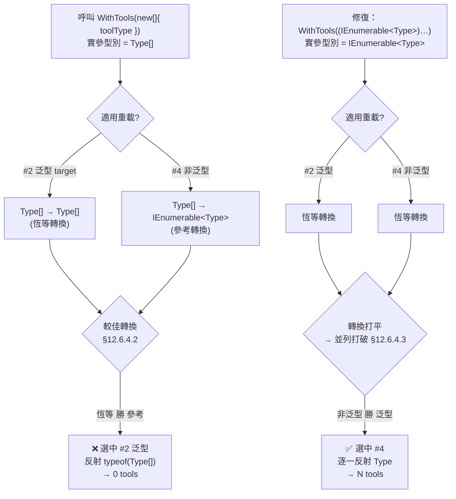

# BUG-001: `AddMcpSubsystem` + `WithTools<T>()` 註冊 0 個工具（C# 重載誤綁）

> **文件性質**：缺陷報告 + 修復提案（供 Core 團隊 review）
> **發現者**：McpGateway.Qsys（UmsApi 子系統移植，ADR-014 首個實作者）
> **影響套件**：`McpGateway.Core` → `Subsystems/McpSubsystemBuilder.cs`
> **嚴重性**：🔴 高（子系統端點 `/{dept}/{system}/mcp` 的 `tools/list` 回傳空陣列，功能完全失效）
> **狀態**：本地已修復並驗證，待 Core 團隊確認後併入

---

## 1. 症狀（Symptom）

子系統透過 Core 的 Fluent API 註冊工具後，MCP 端點**收得到請求但看不到任何工具**：

```
POST /qsys/umsapi/mcp   {"method":"tools/list"}
→ {"result":{"tools":[]}}        ← 空陣列
```

但同時：
- `IMcpSubsystemRegistry.ContainsSubsystem("umsapi")` 回傳 **true**（白名單註冊正常）
- DLL 內確實存在標註 `[McpServerTool]` 的方法（`qsys_umsapi_summary` / `usage` / `quota`）
- 沒有任何例外或錯誤日誌——**靜默失敗**，最難排查的一類 bug

---

## 2. 根因（Root Cause）

### 2.1 問題程式碼

`src/McpGateway.Core/Subsystems/McpSubsystemBuilder.cs`（修復前）：

```csharp
public McpSubsystemBuilder WithTools<TTool>() where TTool : class
{
    return WithTools(typeof(TTool));          // ① 泛型降級為 Type 值
}

public McpSubsystemBuilder WithTools(Type toolType)
{
    ...
    // ② 這裡是 bug 所在
    Services.AddMcpServer().WithTools(new[] { toolType });
    return this;
}
```

呼叫端（以 Qsys 為例，`UmsapiModuleExtensions.cs`）：

```csharp
services.AddMcpSubsystem("umsapi", subsystem =>
{
    subsystem.WithTools<UmsapiReportTool>();   // 走 ① → ②
});
```

### 2.2 MCP SDK 的 `WithTools` 重載群

`ModelContextProtocol` 1.4.1 的 `McpServerBuilderExtensions` 同時提供 **4 個** `WithTools` 重載（擷取自套件 XML 文件）：

| # | 簽名 | 性質 | 語意 |
|---|------|------|------|
| 1 | `WithTools<TTool>(builder, JsonSerializerOptions)` | 泛型 | 反射 `typeof(TTool)` 掃描 `[McpServerTool]` |
| 2 | `WithTools<TToolType>(builder, TToolType target, JsonSerializerOptions)` | 泛型 | 反射 **`target` 物件的運行期型別** 掃描 `[McpServerTool]` |
| 3 | `WithTools(builder, IEnumerable<McpServerTool>)` | 非泛型 | 傳入 tool **實例** |
| 4 | `WithTools(builder, IEnumerable<Type>, JsonSerializerOptions)` | 非泛型 | 傳入 **tool 型別清單** ← **我們真正想呼叫的** |

### 2.3 重載解析如何選錯

第 ② 行 `WithTools(new[] { toolType })` 的實參型別是 **`Type[]`**。編譯器對 `Type[]` 的適用重載：

| 候選 | 轉換 | 是否適用 |
|------|------|----------|
| #2 `WithTools<TToolType>(…, TToolType target, …)` | `Type[]` → `Type[]`（**恆等轉換**，`TToolType` 推論為 `Type[]`） | ✅ |
| #4 `WithTools(…, IEnumerable<Type>, …)` | `Type[]` → `IEnumerable<Type>`（**參考轉換**，陣列協變） | ✅ |
| #1 | `Type[]` 無法綁定到 `JsonSerializerOptions` | ❌ |
| #3 | `Type` 未實作 `McpServerTool` | ❌ |

C# 重載解析規則（C# Spec §12.6.4.2 Better conversion target）：**恆等轉換勝過參考轉換**，因此 **#2 在「較佳轉換」階段就勝出**，根本輪不到「泛型 vs 非泛型」的並列打破規則。

結果：編譯器綁定到 `WithTools<Type[]>(builder, target: new Type[]{ … })`，SDK 把**整個 `Type[]` 陣列當成單一「持有工具的物件」**，去反射 `typeof(Type[])`（也就是 `System.Type[]` 這個陣列型別）上的 `[McpServerTool]` 方法——陣列型別上當然沒有任何自訂工具方法 → **註冊 0 個工具**。

> 對照：#1 泛型重載 `WithTools<TTool>()` 之所以正確，是因為它直接拿**泛型型別參數** `typeof(TTool)` 反射，不涉及「把 Type 當值傳遞」，永遠不會誤綁。

---

## 3. 修復（Fix）

`src/McpGateway.Core/Subsystems/McpSubsystemBuilder.cs`：

```diff
-        // Register tool with the underlying MCP Server builder
-        Services.AddMcpServer().WithTools(new[] { toolType });
+        // Register tool with the underlying MCP Server builder.
+        // 必須顯式轉型為 IEnumerable<Type>，否則 Type[] 會被 C# 重載解析選中泛型重載
+        // WithTools<TToolType>(builder, TToolType target)，把整個陣列當成單一 tool 容器型別反射，
+        // 導致掃描不到 [McpServerTool] 方法而註冊 0 個工具。
+        Services.AddMcpServer().WithTools((IEnumerable<Type>)new[] { toolType });
```

### 3.1 為什麼加 `(IEnumerable<Type>)` 轉型就正確

轉型後實參靜態型別變成 `IEnumerable<Type>`，重載解析重新計算：

| 候選 | 轉換 | 結果 |
|------|------|------|
| #2 泛型 | `IEnumerable<Type>` → `IEnumerable<Type>`（恆等） | 適用 |
| #4 非泛型 | `IEnumerable<Type>` → `IEnumerable<Type>`（恆等） | 適用 |

兩者轉換**變成相同（都是恆等）**，此時才進入並列打破規則（§12.6.4.3）：**「非泛型方法勝於泛型方法」** → 選中 #4（我們真正要的重載）→ SDK 正確逐一反射每個 `Type` 的 `[McpServerTool]` 方法。

一句話：**轉型把 #4 的轉換從「參考轉換」提升為「恆等轉換」，使兩者打平，再由「非泛型優先」規則選對重載。**

### 3.2 更根本的建議（可選，供 Core 團隊評估）

現行 `WithTools(Type)` 內部把單一 `Type` 硬湊成陣列再走 `IEnumerable` 重載，是誤綁的源頭。建議改為直接呼叫泛型 #1 重載，從根杜絕：

```csharp
public McpSubsystemBuilder WithTools(Type toolType)
{
    ...
    // 方案 A（本報告已採用，改動最小）：顯式轉型走 IEnumerable<Type> 重載
    Services.AddMcpServer().WithTools((IEnumerable<Type>)new[] { toolType });

    // 方案 B（更徹底，但需 Core 端多一層泛型轉接）：
    // 讓泛型入口直接呼叫 SDK 泛型重載，完全跳過 Type 值傳遞
    // public McpSubsystemBuilder WithTools<TTool>() => 
    //     ... Services.AddMcpServer().WithTools<TTool>();
}
```

方案 A 已足夠修復且向後相容；方案 B 需評估對既有 `WithTools(Type)` 動態型別呼叫者的影響。

---

## 4. 為什麼 EDCH / Report 沒踩到？（關鍵差異）

這是 Core 團隊最可能的疑問：「同一份 Core，為什麼只有 Qsys 壞？」答案是 **EDCH / Report 根本沒走這條路**。

| 專案 | 工具註冊方式 | 是否經過 `McpSubsystemBuilder` | 受影響 |
|------|-------------|------------------------------|--------|
| **Report** | `AddMcpServer().WithTools<QueryWipTool>()`（`Program.cs`） | ❌ 直接呼叫 SDK 泛型重載 | 否 |
| **EDCH** | `AddMcpServer().WithTools<RawDataTool>()`（`Program.cs`） | ❌ 同上 | 否 |
| **Qsys Umsapi** | `AddMcpSubsystem("umsapi", s => s.WithTools<UmsapiReportTool>())` | ✅ 經 Core Fluent API | **是** |

- Report / EDCH 直接呼叫 **SDK 原生泛型重載 #1**（`WithTools<TTool>()`），泛型型別參數直接反射，**不經第 ② 行的 Type 值傳遞**，天然免疫。
- Qsys 是 **ADR-014「部門內多系統模組化」機制的第一個實作者**，也是目前 workspace 內**唯一**使用 `AddMcpSubsystem` 的專案，因此第一個把潜伏的 bug 炸出來。

> ⚠️ **EDCH / Report 是「倖存者」，不是「正確示範」。** 它們只是恰好繞過了有缺陷的 Core 子系統機制。

---

## 5. 影響範圍（Blast Radius）

### 5.1 腳手架範本自帶此 bug（最重要）

`templates/template-module/__System__ModuleExtensions.cs` 第 40 行預設生成：

```csharp
services.AddMcpSubsystem("__system__", subsystem =>
{
    subsystem.WithTools<__ToolClass__Tool>();   // ← 每個新模組開場即 0 tools
});
```

**今天不修，未來每個照範本新建的子系統都會踩同一個洞**，且都是靜默失敗。這是把修復納入 Core 的最高理由。

### 5.2 現有整合測試有盲區

`tests/McpGateway.Core.IntegrationTests/Subsystems/` 下的測試只驗證 `IMcpSubsystemRegistry` 註冊成功（`ContainsSubsystem == true`），**未斷言「MCP server 實際可見的 tool 數 > 0」**，所以 CI 綠燈也擋不住這個 bug。

---

## 6. 驗證（Verification）

修復套用於 Qsys Host（Development，免認證）後的端到端結果：

| 測試 | 修復前 | 修復後 |
|------|--------|--------|
| `GET /qsys/umsapi/mcp` `tools/list` | `[]`（0） | **3**（summary / usage / quota） |
| `GET /qsys/mcp`（部門端點）`tools/list` | 缺 umsapi 工具 | **4**（qsys_hello + 3 umsapi） |
| `tools/call qsys_umsapi_summary` | 找不到工具 | `IsError=False`，真實資料 |
| `tools/call qsys_umsapi_usage`（僅 deptId） | — | `IsError=False` |
| `tools/call qsys_umsapi_quota` | — | `IsError=False` |
| `tools/call` 無效 deptId | — | `IsError=True` + 友好提示（設計行為） |

每次 `tools/call` 皆成功自 Consul KV 解析下游 BaseUrl，無 fallback。

### 6.1 建議補強的回歸測試（給 Core）

在 Core 整合測試補一條「端點可見工具數」斷言，把契約固化：

```csharp
[Fact]
public async Task SubsystemEndpoint_ExposesRegisteredTools()
{
    // Arrange：AddMcpSubsystem("mes", s => s.WithTools<MesTool>())
    // Act：對 /{dept}/mes/mcp 發 tools/list
    // Assert：tools.Length == 預期數量（> 0）
    Assert.NotEmpty(tools);
}
```

Qsys 端已先補一個 schema 級契約測試（`UmsapiReportToolTests.ToolSchema_OnlyDeptIdIsRequired`），用 `AIFunctionFactory.Create(...).JsonSchema` 直接驗證生成 schema，可作為 Core 補測的參考寫法。

---

## 7. 附註：建置環境注意事項（非本 bug）

排查期間另發現：以 **.NET SDK 10**（Roslyn 較嚴格）編譯 `Cache/RedisTokenCacheService.cs:45` 會報 `CS0121`（`RedisValue` 同時可隱式轉 `string` / `byte[]`，`JsonSerializer.Deserialize` 多載模稜兩可）。

- **這不是本 bug 的一部分，也非 Core 邏輯錯誤**，純屬 SDK 10 編譯器行為差異；SDK 9.0.318 可正常編譯原始碼。
- 本地已用 workspace 根 `global.json`（pin `9.0.318`）規避。
- **建議 Core 團隊把 `global.json` 提交進 Core repo**（目前為 untracked），以免 CI 或同事升級 SDK 10 時踩到 CS0121。若要長治，可將該行改為 `JsonSerializer.Deserialize<ToolContext>((string)cachedValue!)` 顯式指定多載。

---

## 8. 給 Core 團隊的行動建議摘要

1. ✅ **合併 `McpSubsystemBuilder.WithTools(Type)` 的 `(IEnumerable<Type>)` 轉型修復**（本報告 §3）。
2. ✅ **同步修 `templates/template-module` 或確認範本走的是泛型入口**，避免新模組重複踩坑（§5.1）。
3. ✅ **補一條「子系統端點 tools/list 非空」的整合測試**，堵住 CI 盲區（§6.1）。
4. 🔧 （可選）評估 §3.2 方案 B，從 API 設計面根除 Type 值誤綁。
5. 🔧 （可選）提交 `global.json` 固定 SDK 9.0.318，或修 CS0121（§7）。

---

## 附：重載解析決策流程圖


