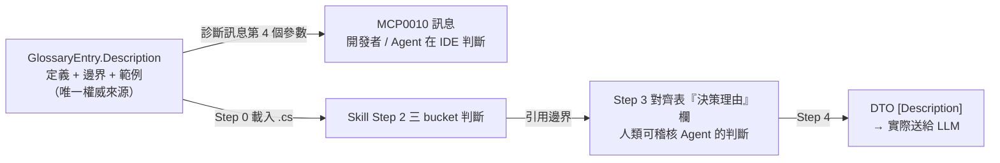

# Issue #14 - 詞彙庫缺乏語意邊界，且詞條描述未送達命名判斷現場

> **狀態**：方案已決議（見 §6），實作依 §7 進行。
> **追蹤票**：[#14](http://tncimweb.cminl.oa/git-server/CIM-1-3-1/McpGateway.Core/issues/14)
> **建立日期**：2026-10-22
> **類型**：Architecture / DX / Tech Debt
> **前置**：[Issue #11](issue-11-glossary-tier-governance.md)（詞彙治理單層化）已收斂出單一權威來源 `Tier1Vocabulary.cs`；本文件處理該來源**內容層**的缺陷。

## 1. 問題描述

直接觸發點：下游子系統編譯時出現 `MCP0010` 警告，提示 `StartTime` 應改名為 `StartHours`。該提示**在詞庫定義下是正確的**（`startTime` 當時確實是 `startHours` 的別名），但對實際欄位是**誤判**——該欄位承載的是「一日内時刻」，而 `startHours` 是「自下線起算的持續時數」，兩者語意不同。

盤點後確認這是三個互相關聯的缺陷，共同根因是：**詞庫只定義了「一個詞是什麼」，沒有定義「它與近義詞如何區分」，也沒有任何機制驗證名稱佔用的唯一性。**

1. **語意辨析只存在於 `//` 註解，不在資料模型中**：`startHours` 的定義文字 `下線時間 (Start Duration in Hours)` 本身有兩種解讀（下線的時刻 / 下線以來的時數）。真正的辨析寫在緊鄰的 `// 註：` 裡，而註解不是資料的一環——分析器讀不到、Code Fix 讀不到、AI Skill 也不會把它當作判斷依據。
2. **詞條 `Description` 寫了，但沒有送達做判斷的那個瞬間**：開發者看到 `MCP0010` 時，畫面上只有「符號名、別名、標準名」三個名字，沒有任何判斷依據（詳見 §2.2）。
3. **詞庫分段失衡，影響 AI Skill 的辨析品質**：`Tier1Vocabulary.cs` 第一段 `// 實體識別碼` 容納 27 條（全庫共 40 條），混雜 ID、數量、時數、站點、產線；近義詞分散各段，LLM 在比對時不易把它們放在一起辨析（詳見 §2.5）。

此外盤點發現**同型缺陷在相鄰詞條中仍然存在且尚未修正**（`stayHours` 的 `stayTime`、`scheduledCompletion` 的 `targetDate` 等），見 §2.6——這代表本次若只修 `startHours` 一條，同類問題仍會在其他欄位上重演。

### 1.1 本次已先行處置的部分（已落地）

`startHours` 的 `startTime` 別名已移除，`startTime`（時刻）與 `startDate`（日期）已收錄為獨立標準詞彙，並補上兩條回歸測試；[Issue #11 §6.6](issue-11-glossary-tier-governance.md) 中 `StartTime → startHours` 的兩筆建議已標註失效並指向本文件。

> **版本歸屬**：`v0.2.3-preview` 已於 2026-10-19 進板並打 tag（commit `1496eb8`），上述詞條修正**尚未進板**，故不列入 0.2.3 章節；已以註解形式暫記於 [ReleaseNote.md](../../ReleaseNote.md) 頂部，待下次 `chore(release)` 進板時移入新版本章節。

**本文件處理的是讓同一類錯誤不再發生的系統性機制**，而非該單點修正本身。

## 2. 根本原因分析

### 2.1 `FindByAlias` 以 `FirstOrDefault` 靜默吞掉名稱衝突

```csharp
public static GlossaryEntry? FindByAlias(string name) =>
    Entries.FirstOrDefault(e => e.Aliases.Any(a => string.Equals(a, name, StringComparison.OrdinalIgnoreCase)));
```

當 `startTime` 同時是 `startHours` 的別名、又足以成為獨立標準詞時，`FirstOrDefault` 只會靜默選取陣列中先出現的那一條，**不報錯、不警告、無從發現**。

這並非首次發生。`Tier1Vocabulary.cs` 中 `stepId` 上方那段註解：

> `// 註：CoreGlossary.cs 將 processId 列為 stepId 的別名……因此 stepId 的別名清單刻意不含 processId，避免 FindByAlias 對同一別名產生兩個詞彙的歧義對應。`

就是同一個坑的第二次踩法。差別只在 `processId` 那次有人發現並用註解標記，`startTime` 這次一路走到下游編譯警告才被發現。**用人工註解承擔本應由測試強制執行的規則，是本次问题的直接成因。**

### 2.2 診斷訊息未攜帶詞庫定義

`McpNamingAndDescriptionAnalyzer.RuleAlias` 的 `messageFormat` 只有三個佔位符：

```
Symbol '{0}' uses legacy alias '{1}', suggest renaming to standard term '{2}'
```

`McpNamingAndDescriptionCodeFixProvider` 的 Code Fix 標題同樣只有 `Rename to standard domain term '{standardName}'`。詞條 `Description` 在整個 repo 中**沒有任何程式碼讀取**。

### 2.3 `Description` 的實際讀者盤點

| 潛在讀者 | 是否讀得到 `Description` | 說明 |
|---|---|---|
| 看到 `MCP0010` 警告的開發者 | ❌ | 訊息只有三個名稱（§2.2） |
| 一鍵套用的 Code Fix | ❌ | 標題只有標準名 |
| `mcp-tool-dto-builder` Skill | ✅ | Step 0 直接把 `.cs` 原文讀進 context，這是**唯一**讀者 |
| 下游 LLM（MCP tool schema） | ❌ | 讀的是 DTO 屬性上的 `[Description]`，不是詞庫 |

結論：詞條描述**在內容上大致足夠**（對 `productId`、`lotId` 這類欄位，一句話定義本來就夠）；**在傳遞上不足**——它只服務 Skill，不服務在 IDE 裡做判斷的人或 Agent。

### 2.4 現有測試未涵蓋詞庫自身的一致性

`tests/McpGateway.Analyzers.Tests/McpNamingAndDescriptionAnalyzerTests.cs` 現有 5 條測試全部驗證「診斷是否正確觸發/不觸發」，**沒有任何一條**驗證詞庫自身的一致性（標準名稱是否重複、別名是否撞名、同一別名是否被兩條詞項搶佔）。因此 §2.1 的靜默衝突目前無任何防護網。

### 2.5 詞庫分段現況

| 段落標註 | 詞條數 | 問題 |
|---|---|---|
| `// 實體識別碼` | **27** | 垃圾桶段落：混雜 ID、名稱、數量（`lotCnt`/`sheetCnt`/`panelCnt`）、時數（`stayHours`/`startHours`）、站點（`stepId`/`workCenter`）、產線 |
| `// 搬送/倉儲位置` | 4 | 恰當 |
| `// 生產計量與良率指標` | 5 | 恰當 |
| `// 狀態與時間戳記` | 4 | 混入 `scheduledCompletion`，且與上一段的時間詞條相鄰卻不同段 |

時間語意的註解（§1 第 1 點）掛在單一條目上方，正是因為沒有地方可以放「一組詞的辨析」，只能塞在單條旁邊。

### 2.6 同一類缺陷在相鄰詞條中仍然存在（尚未修正）

`startHours` 的 `startTime` 別名已修，但**同一群的其他詞條仍帶著完全同型的模糊別名**。這些別名本身即為「時刻/日期/時間戳記」語意的常用命名，一旦下游出現同名欄位，就會重演本次誤判：

| 詞條 | 現行別名 | 問題 |
|---|---|---|
| `stayHours`（停留時數） | `stayTime`、`dwellTime` | `*Time` 通常指時刻或時間戳記，非時數 |
| `scheduledCompletion`（預計完工時間） | `targetDate`、`dueTime` | `targetDate` 明確是**日期**語意，卻掛在時間戳記詞條下 |
| `generatedAt`（UTC 時間戳記） | `createTime`、`reportTime` | 同 `*Time` 問題 |

這說明本次修正若只處理 `startHours` 一條，等於**只修了已爆出來的那一個**，同型風險仍在。因此 §5.1 的邊界規範應以「群」為單位處理，而非逐條修補；且 §7.1 的測試只能鎖住已修好的部分，無法發現上列尚未被任何人踩到的衝突。

## 3. 影響範圍

| 類別 | 項目 |
|---|---|
| 詞庫本體 | `src/McpGateway.Analyzers/Tier1Vocabulary.cs`（詞條描述、分段、缺乏一致性驗證） |
| 分析器 | `src/McpGateway.Analyzers/McpNamingAndDescriptionAnalyzer.cs`（`RuleAlias` 訊息未含詞庫定義） |
| Code Fix | `src/McpGateway.Analyzers/McpNamingAndDescriptionCodeFixProvider.cs`（同上） |
| 測試 | `tests/McpGateway.Analyzers.Tests/`（無詞庫一致性測試） |
| AI Skill | `docs/ai-tools/skills/mcp-tool-dto-builder/SKILL.md`（Step 2 三 bucket 判斷、Step 3 對齊表的「決策理由」欄缺乏依據來源）、`WORKFLOW.md` §4.1（詞庫 PR 範本） |
| 下游 | `McpGateway.Qsys.Issapi` 的 `BplanJobFullDto.cs:41`、`GurobiUsageDto.cs:21` 兩個 `StartTime` 欄位（見 Issue #11 §6.6，需逐欄位確認實際語意後才決定是否改名） |

## 4. 方案評估（W／C／A-full 已排除，A-min 已採）

> 本節記錄評估過程，避免後人重複評估同一方向。

### 方案 W：另立一份語意文件（如 `docs/vocabulary.md`）— 排除

獨立的詞彙語意文件等於第三份宣稱權威的來源，直接違反 [GLOSSARY.md](../../GLOSSARY.md)「詞彙權威來源（Vocabulary Authority）」條目：

> 多份文件或程式碼宣稱提供同一層級的詞彙時，必須明確指定其中一份為權威來源，其餘應視為衍生文件或刪除。

Issue #11 的成因正是「多份定義、無同步機制」。此外，獨立文件既不會被分析器強制執行，也不會被 Skill 讀取，等於新增一個漂移來源。**唯一適合文件化的是「撰寫規範」（規則），不是「詞條內容」。**

### 方案 C：詞庫改為 JSON（嵌入資源 / 編譯期產生）— 暫緩

| 面向 | 現況（C# 原始碼） | 方案 C |
|---|---|---|
| 分析器取得詞庫 | 讀靜態陣列，零 I/O | 嵌入資源需 `System.Text.Json`；Analyzers 是 `netstandard2.0`，帶 `System.Memory`/`System.Buffers` polyfill 是傳統地雷，且需在 VS / `dotnet build` / language server 三種載入環境皆驗證 |
| Skill 取得詞庫 | 走 `WORKFLOW.md` P1–P5 五層探測，最終 `tea repo clone` 抓 Gitea tag | 可直接讀 `~/.nuget/packages/mcpgateway.core/<專案引用版>/` 下的 JSON |
| 版本一致性 | Skill 讀的版本與專案引用的分析器版本**可能不同** | 一致（讀的就是已安裝版本） |
| 詞庫自身正確性 | 無檢查 | 產生器可在 build 階段直接 fail |

**排除理由**：方案 C 只改善**讀取路徑**，但 Skill 的 Step 5（詞庫回饋 PR）**本來就必須走 Gitea**，C 無法消除該依賴；而 C 能省下的只是 P4 這條很少真的被走到的路徑（P1 工作區 Glob、P2 ProjectReference 在多數開發環境即已命中）。以目前 3 個下游 repo 的規模，收益撐不起成本。

**保留價值（未來若重啟可優先考慮 C-2 變體）**：JSON 為 repo 內權威來源，build 時產生 `Tier1Vocabulary.g.cs`。此時分析器仍讀純 C#（零相依、零 I/O），下游 `MCP0010/0011/0012` 行為完全不變，而「別名撞名」「跨語意類別」等規則可在 build 階段直接失敗。需注意產生檔應 `.gitignore` 或標註為衍生檔，以符合「詞彙權威來源單一性」規則。

### 方案 A-full：`GlossaryEntry` 增加 `Kind`/`Unit`/`ExpectedType`/`FormatExample`/`UsageNote` — 排除

曾評估以結構化欄位承載語意（`TermKind` 枚舉區分 Duration/TimeOfDay/CalendarDate 等）。**排除理由**：

1. **40 條詞條中約 30 條（ID、名稱、狀態類）的 `Unit`/`FormatExample` 只能填空字串**。「必填但多數填空」的設計必然腐敗。
2. **惡化下游貢獻成本**：依 `SKILL.md` Step 5，詞庫擴充由下游開發者 + AI 自動產生 PR。9 個位置參數的 constructor 意味著每個 AI 生成的 PR 都要把枚舉、常數、單位、格式全部寫對才能過編譯，中央團隊 review 負擔直接上升。
3. **錯置關注點**：「`startHours` 的 C# 型別該是 `double` 而非 `DateTime`」是**分析器對 DTO 屬性的型別檢查**，其依據是屬性的實際宣告，不該由詞庫承擔。詞庫管命名，型別歸分析器看實際宣告。

### 方案 A-min：語意邊界寫回 `Description` + 送達判斷現場 + 撞名測試 — **✅ 已採決議（2026-10-22，見 §6 #1）**

不新增欄位、不新增檔案、不動 constructor 簽章；把「與誰不同」寫進既有 `Description` member，並讓它在診斷訊息與 Skill 判斷表上可見，最後用測試強制名稱佔用的唯一性。

- **優點**：零 schema 變更、下游原始碼零異動、AI 提 PR 的格式不變；直接解掉 §2.1–§2.4 四個根因。
- **缺點**：`Description` 字串長度與品質需靠撰寫規範與 review 維持，無法由型別系統強制；詞條重排會造成一次較大的 diff（但純移動，無語意變更）。

## 5. 已採方案設計（方案 A-min，決議見 §6）



### 5.1 詞條描述撰寫規範（三段式）

```
<定義>。<邊界：與哪個近義詞不同、如何判斷>。<範例>
```

**僅「易混淆群」需要寫邊界**，其餘詞條維持一句話定義即可（避免 §4 A-full 的空字串問題在文字層重演）：

| 群 | 涉及詞條 | 邊界要點 |
|---|---|---|
| 時間 | `startHours` `startTime` `startDate` `stayHours` `scheduledCompletion` `generatedAt` | 持續時數 / 一日内時刻 / 日期 / 絕對時間戳記，四者不可互為別名；**並一併處理 §2.6 列出的 `stayTime`/`dwellTime`/`targetDate`/`dueTime`/`createTime`/`reportTime` 等模糊別名** |
| 計數 | `lotCnt` `sheetCnt` `panelCnt` `totalItems` | 計數主體不同（LOT / 玻璃 / Panel / 查詢筆數） |
| 數量與良率 | `quantityInProcess` `quantityCompleted` `defectCount` `yieldRate` | 絕對數量 vs 比率（0.0~1.0） |
| 設備階層 | `eqptId` `subEqptId` `chamberId` `portId` | 主設備 → 子設備 → Chamber → 裝卸埠 |
| 位置階層 | `zoneId` `shelfId` `patiId` `position` | AMHS 位置四層 |
| 站點與產線 | `stepId` `processId` `workCenter` `productLine` | 現存 `// 註解` 內容移入此處 |

約 6 群、20 條左右。

> **§2.6 的別名處置已決議（§6 #4）：全部保留、不動別名清單**，僅補邊界描述。邊界文字須讓開發者能自行判斷——例如 `scheduledCompletion` 的描述需寫明「本詞條為絕對時間戳記；若欄位僅為日期請用 `startDate`/`endDate`」，使 `targetDate` 觸發的建議自带辨析，判斷權交回開發者。

範例：

```csharp
new GlossaryEntry("startHours", "StartHours",
    "自下線起算的持續時數，小數小時（例 304.969）。非時刻；" +
    "若欄位為一日内時刻請用 startTime，若為日期請用 startDate。",
    new[] { "downTime", "startDurationHours" }),

new GlossaryEntry("startTime", "StartTime",
    "一日内時刻，僅時分秒 HH:mm:ss（例 14:30:00），不含日期。" +
    "不同於 startHours（持續時數）與 startDate（日期）。",
    new[] { "timeOfDay", "clockTime", "timeStr" }),

// 無近義詞者維持一句話定義，不硬湊三段
new GlossaryEntry("productId", "ProductId",
    "產品料號或唯一代碼 (Product ID)，例 P-1002。",
    new[] { "productCode", "prodId", "itemNo", "partNo", "materialNo", "PROD_ID" }),
```

原本掛在單一條目上方的兩段 `// 註解`（`processId`、時間語意）內容移入對應詞條的邊界描述或 §5.4 的段落標註，不再以註解承擔規則。

### 5.2 `MCP0010` 診斷訊息帶上詞庫定義（並全盤中文化）

依 §6 #2/#3 決議：完整附加描述、三條診斷與 Code Fix 標題一併中文化。

```csharp
// MCP0010（第 4 個佔位符 = 詞條 Description，完整附加不截斷）
"符號 '{0}' 使用了歷史別名 '{1}'，建議改為標準詞 '{2}'（{3}）。若語意不符請忽略此警告。"

// MCP0011
"屬性 '{0}'（MCP DTO '{1}'）缺少 [Description] 特性，請補上繁體中文語意說明與格式範例。"

// MCP0012
"屬性或參數 '{0}' 應使用不含底線的標準 camelCase/PascalCase 命名。"
```

呼叫端僅多傳一個 `aliasMatch.Description`。效果：

```
符號 'StartTime' 使用了歷史別名 'StartTime'，建議改為標準詞 'StartHours'
（自下線起算的持續時數，小數小時…）。若語意不符請忽略此警告。
```

`McpNamingAndDescriptionCodeFixProvider` 的 Code Fix 標題同步中文化並帶上描述（`改名為標準詞 'StartHours'（自下線起算的持續時數…）`），讓開發者在套用前即可判斷。

> 實作注意（已核對程式碼）：
> - `RuleAlias` 以 `MessageFormat` 承載 3 個佔位符，新增第 4 個需同時更新 Analyzer 內**兩處** `Diagnostic.Create`（`AnalyzeProperty` 傳 `StandardPascal`、`AnalyzeParameter` 傳 `StandardCamel`），否則執行期訊息會出現未格式化佔位符。
> - Code Fix **不是**從 `Diagnostic` 讀取標準名，而是對語法節點重跑一次 `Tier1Vocabulary.FindByAlias(node.ToString().Trim('"', ' '))`。因此要在標題帶出描述，需在該處另行取用 `aliasMatch.Description`，並非改訊息格式即可自動生效。
> - 該 `Trim('"', ' ')` 表示 Code Fix 也可能命中**字串字面值**（例如 JSON schema 內的欄位名），此路徑無 `Description` 可插入，需確認標題在此情境仍正確。

### 5.3 詞庫一致性驗證器 + 測試（新增）

規則刻意保持最小，且**與時間/欄位類型無關**，對 Identifier、Quantity、Status 類詞條同樣有效：

1. camelCase 標準名稱不得彼此重複；PascalCase 標準名稱不得彼此重複。
   > ⚠️ **實作陷阱（已實際踩過）**：不可把 `StandardCamel` 與 `StandardPascal` 丟進同一個集合再做大小寫不敏感分組——`productId` 與 `ProductId` 必然相撞，會使**全部 40 條詞條都誤報**。兩組必須各自分組比對。
2. 別名不得撞上任何標準名稱（含自己那條）。
3. 同一別名不得同時屬於兩條詞項（`FindByAlias` 會靜默選第一個）。

```csharp
[Fact]
public void Tier1Vocabulary_HasNoAmbiguousAliases()
{
    Assert.Empty(Tier1VocabularyValidator.Validate(Tier1Vocabulary.Entries));
}
```

**已對現行詞庫試算**（2026-10-22，40 條詞條、127 個別名）：以 §5.3 修正後的規則（camel 與 Pascal 分別分組）執行，三條規則均為 **0 筆錯誤**，故本測試在當前行為下即可通過，無需先修資料。

#### 本驗證器能與不能擋住的（重要）

| 情境 | 能否擋住 | 說明 |
|---|---|---|
| 有人把 `startTime` 加回 `startHours` 的 aliases | ✅ 規則 2 | 因 `startTime` 現已是標準名稱 |
| 兩條詞項搶同一個別名（`processId`/`stepId` 那類） | ✅ 規則 3 | 不再需要 `//` 註解提醒 |
| **本次的原始錯誤**（修正前：`startTime` 僅作為 `startHours` 的別名） | ❌ | 當時詞庫在結構上**完全自洽**——`startTime` 只是未被收錄為獨立詞項，無任何名稱衝突。錯的是**語意歸屬**，不是結構 |

> 結論：驗證器屬**防回歸**機制，不是本次誤判的成因解。語意正確性需要領域知識，無法由測試判定，只能靠 §5.1（詞條含邊界）與 §5.2（邊界送達判斷現場）讓判斷者有依據可自行否決建議。兩者互補，但主角是 §5.1/§5.2。

### 5.4 詞庫檔內重新分段（純重排，零 schema 變更）

> 下表共 40 條，與現行 `Tier1Vocabulary.cs` 詞條數一致（現況分段為 27/4/5/4），逐條重新歸屬，**無新增、無刪除、無改名**。`endDate`（§6 #5 決議收錄）為**另外的資料變更步驟**（§7.2 #3），不混入本次重排，重排後時間段落為 7 條。

| 段落 | 詞條 |
|---|---|
| 產品與版本 | `productId` `productName` `ecCode` |
| 設備與製程資源 | `eqptId` `subEqptId` `chamberId` `portId` `recipeId` |
| 載具與生產對象 | `lotId` `workOrderId` `carrierId` `glassId` `panelId` `waferId` |
| 製程站點與產線 | `processId` `stepId` `stepName` `workCenter` `productLine` `ownerId` |
| 時間與持續時間 | `stayHours` `startHours` `startTime` `startDate` `scheduledCompletion` `generatedAt` |
| 計數與良率指標 | `lotCnt` `sheetCnt` `panelCnt` `quantityInProcess` `quantityCompleted` `totalItems` `defectCount` `yieldRate` |
| 搬送/倉儲位置 | `zoneId` `shelfId` `patiId` `position` |
| 狀態與優先等級 | `status` `priority` |

分段的功能價值：Skill 是把整個 `.cs` 當文字讀入，詞條在檔內的**相鄰順序即 LLM 比較的順序**。近義詞集中同段，Agent 才會真的去辨析。

**不拆成多個檔案**：`WORKFLOW.md` Step 0 的 P1 探測是 `**/Tier1Vocabulary.cs` 這個 glob，拆檔（如 `Tier1Vocabulary.Time.cs`）不會命中，詞庫探測會靜默失敗並掉到 P4 去 clone Gitea。

**不加 `Category` 欄位**：理由同 §4 A-full——40 條都得填，且 `startHours` 同時屬於「時間」與「WIP 指標」，歸屬會變成 PR 上的爭論。分類用檔內段落表達即可，它是給人與 LLM 看的線索，不需要是強制資料。

### 5.5 Skill 文件同步

- `SKILL.md` Step 3 對齊表的「備註 / 決策理由」欄：要求引用詞庫邊界作為判斷依據，而非僅寫 `校正已知別名 (MCP0010)`。目標形態：

  | 原始欄位 | 建議標準名稱 | 分類 | 決策理由 |
  |---|---|---|---|
  | `START_HRS` | `StartHours` | ⚠️ 別名校正 | 值為小數時數 304.969，屬持續時間，非時刻 |
  | `START_TIME` | `StartTime`（**不改名**） | ✅ Tier 1 標準詞 | 詞庫邊界：HH:mm:ss 時刻，與 startHours 為不同概念 |

  第二列即本次誤判的正確處理形態：Agent 依邊界自行得出不改名的結論，而非照抄診斷建議。
- `WORKFLOW.md` §4.1 的 `new GlossaryEntry(...)` 兩段範本需與 §5.1 規範一致，否則 AI 生成的詞庫 PR 會缺少邊界。
- 撰寫規範（三段式、哪些群必須寫邊界）寫入 `CONTRACT_RULES.md` 或 `SKILL.md` 一小節。**文件化的是規則，不是詞條內容**（見 §4 方案 W）。

### 5.6 （選擇性）`MCP0011` Code Fix 直接填入詞條描述

閱讀 `McpNamingAndDescriptionCodeFixProvider.AddDescriptionAttributeAsync` 發現：它對缺 `[Description]` 的屬性一律插入**寫死的佔位文字**：

```csharp
SyntaxFactory.Literal("欄位說明")   // 開發者仍需自行改寫
```

若屬性名稱命中詞庫標準詞（`FindByAlias` 的反向查詢，或對照 `StandardPascal`），Code Fix 可直接插入該詞條的 `Description`，開發者只需補上本工具特有的限定。這是讓語意「送達寫程式現場」的另一條路徑，且與 §5.2 共用同一份描述來源，不新增維護成本。

- **優點**：`MCP0011` 目前只能提示「缺描述」，這是唯一能让它**自動補出正確描述**的做法；也直接改善下游 LLM 讀到的 tool schema 品質。
- **缺點／風險**：詞條描述是**跨系統通用**的定義，未必含該工具的上下文限定（例如是否需要 UTC、是否可為空），自動填入可能給出「正確但不完整」的描述，需靠 review 把關。建議僅在描述非空時填入，並在描述後附加標記（如 `/* 請補上本工具特有限定 */`）提醒修改。
- 實作上需先為 `Tier1Vocabulary` 增加「依標準 Pascal 名稱查詞條」的輔助方法（現僅有 `FindByAlias`）。

## 6. 決議記錄（2026-10-22 逐項確認）

> 原待決事項已逐項與負責人確認，結論如下；§7 實作計畫已依此調整。

| # | 事項 | 決議 |
|---|---|---|
| 1 | 整體方案 | ✅ **採方案 A-min**（§5）。C-2 維持 §4 結論：暫緩，待下游 repo 規模或離線需求出現再評估。 |
| 2 | 診斷訊息長度 | ✅ **完整附加詞庫描述**，不截斷、不用 `AdditionalInfo`。理由：開發者必須看到邊界才能自行判斷是否改名，截斷會恰好切掉辨析句。 |
| 3 | 診斷訊息語言 | ✅ **MCP0010/0011/0012 三條診斷與 Code Fix 標題全部中文化**，與詞條描述語言一致，降低解讀成本。既有測試的訊息斷言（`Assert.Contains`）需同步檢查。 |
| 4 | §2.6 模糊別名（`stayTime`/`dwellTime`/`targetDate`/`dueTime`/`createTime`/`reportTime`） | ✅ **全部保留，不動別名清單**；僅補邊界描述。邊界文字須明確寫出「本詞條為時數/時間戳記語意；若欄位為時刻請用 `startTime`、日期請用 `startDate`」之類辨析，把判斷權交回開發者。 |
| 5 | `endDate` | ✅ **一併收錄** `endDate`（與 `startDate` 對稱；MockOcelotApi 已實際使用）。別名建議 `finishDate`/`toDate`/`dateEnd`，最終清單於 §7.2 實作時定案。 |
| 6 | 詞條品質把關機制 | ✅ **PR checklist + 規範寫入 SKILL.md/CONTRACT_RULES.md 兩面都做**：SKILL.md 管 AI 生成詞條時怎麼寫邊界；PR description 增設「詞條品質自查」段（名稱衝突自查、是否命中易混淆群、邊界三段是否齊備），中央 reviewer 只做抽驗。CI 強制檢查（§4 選項 3）列為後續待辦，本期不做。 |
| 7 | ADR-010 | ✅ **修訂 ADR-010**，加入兩條原則：「詞條描述須含語意邊界（定義＋辨析＋範例）」與「診斷訊息須送達詞條描述，供開發者判斷語意」。 |
| 8 | Qsys `StartTime` 欄位語意 | ✅ **保留為待辦**，由 Qsys 團隊確認 `BplanJobFullDto.cs:41`、`GurobiUsageDto.cs:21` 實際存放語意（時刻 or 下線時數）後決定是否改名。工具側不做假設。 |

- [x] 正式於 Gitea 開立追蹤票 [#14](http://tncimweb.cminl.oa/git-server/CIM-1-3-1/McpGateway.Core/issues/14)，本文件已自 `issue-12-*` 更名並補上票號連結（原佔位 #12 已被 PR 佔用，實際票號為 #14）。

## 7. 實作計畫與驗證

> 順序建議：7.1 與 7.3 完全無爭議且獨立於其餘項目，可先做；7.2 需 review 描述文字品質；7.4 為純文件。

### 7.1 詞庫一致性防護（無爭議，建議先做）

| # | 待辦事項 | 驗證方式 |
|---|---|---|
| 1 | 新增 `Tier1VocabularyValidator`（§5.3 三條規則） | 對現有詞庫執行應回傳 0 筆錯誤（`processId`/`stepId` 已刻意避開，應通過） |
| 2 | 新增 `Tier1Vocabulary_HasNoAmbiguousAliases` 測試 | `dotnet test` 通過；刻意把 `startTime` 加回 `startHours` 的 aliases 應使測試**失敗**，驗證後還原 |

### 7.2 詞條語意邊界與分段

| # | 待辦事項 | 驗證方式 |
|---|---|---|
| 1 | 依 §5.4 重排 `Tier1Vocabulary.cs` 為 8 段，兩段既有 `// 註解` 內容移入段落標註或詞條邊界 | 詞條**數量與標準名稱逐條核對無增減、無改名**（此步驟僅移動與調整描述文字）；`git diff` 確認無標準名稱被改動 |
| 2 | 依 §5.1 為 §5.1 表中 6 個易混淆群補上邊界與範例；§2.6 的模糊別名**保留不動**（§6 #4），邊界文字須含「若欄位為 X 語意請用 Y」式辨析 | 人工逐群 review；`Description` 不含未定義佔位文字；`git diff` 確認各詞條 `Aliases` 陣列未被改動 |
| 3 | 新增 `endDate` 標準詞條（§6 #5），與 `startDate` 相鄰放置於「時間與持續時間」段；別名清單（建議 `finishDate`/`toDate`/`dateEnd`）於實作時定案 | §7.1 測試通過（`endDate` 不得與任何既有名稱/別名衝突）；描述含與 `startDate`/`scheduledCompletion` 的邊界 |
| 4 | `dotnet build` + `dotnet test`（Core 方案） | 建置成功、無新增警告；全部測試通過 |

> 步驟 1 與步驟 2/3 應分開提交：步驟 1 是純重排（`git diff` 應只顯示移動），步驟 2/3 才是內容變更。混在一起會讓 review 無法快速確認「有沒有詞條被動到」。

### 7.3 診斷與 Code Fix 送達描述（含全盤中文化，§6 #2/#3）

| # | 待辦事項 | 驗證方式 |
|---|---|---|
| 1 | `RuleAlias` `messageFormat` 增加第 4 個佔位符（詞條 `Description`，完整不截斷）並中文化；更新 property 與 parameter 兩處 `Diagnostic.Create` | 新增測試斷言訊息**含詞庫描述文字**；兩條既有別名測試（`wc`、`startDurationHours`）仍通過 |
| 2 | `RuleMissingDesc`、`RuleInvalidFormat` 的 `messageFormat`/`Title` 中文化（§5.2） | 既有 `MCP0011`/`MCP0012` 相關斷言若比對英文訊息需同步修正；`dotnet test` 全數通過 |
| 3 | `McpNamingAndDescriptionCodeFixProvider` 兩處 Code Fix 標題中文化，`MCP0010` 標題帶上描述（注意：該處另行呼叫 `FindByAlias`，非讀 `Diagnostic`，見 §5.2 實作注意） | 手動於 IDE 驗證提示文字（或 Code Fix 單元測試）；確認命中**字串字面值**路徑時標題仍正確 |
| 4（選擇性，§5.6） | `MCP0011` Code Fix 命中標準詞時直接填入詞條 `Description`，取代寫死的 `"欄位說明"`；需新增「依標準 Pascal 名稱查詞條」輔助方法 | 新增測試：對名為 `ProductId` 且缺 `[Description]` 的屬性套用 Code Fix，產出內容含詞條描述而非 `欄位說明` |

> ⚠️ 中文化屬**診斷訊息破壞性變更**：下游若有以訊息文字進行的 CI 比對、或 `NoWarn` 之外的文字篩選，需在 ReleaseNote 標註。診斷 ID（`MCP0010` 等）不變，`#pragma warning disable` 與 `.editorconfig` 設定不受影響。

### 7.4 Skill、文件與 ADR

| # | 待辦事項 | 驗證方式 |
|---|---|---|
| 1 | `SKILL.md` Step 3 要求「決策理由」欄引用詞庫邊界（§5.5 範例） | 以 `docs/ai-tools/use-mcp-tool-dot-builder.md` 的 WIP 範例實際跑一次 skill，確認對齊表出現含邊界引用的理由，且 `START_TIME` 不被誤改名 |
| 2 | `WORKFLOW.md` §4.1 範本與 §5.1 規範對齊；三段式撰寫規範寫入 `CONTRACT_RULES.md`（§6 #6：管「AI 生成時怎麼寫」） | 人工 review 兩份文件不再出現與 §5.1 衝突的範本 |
| 3 | `WORKFLOW.md` §5 的 PR description 範本增設「詞條品質自查」段（§6 #6：管「提交前怎麼自查」）：名稱衝突自查、是否命中易混淆群、邊界三段是否齊備、附「提議詞條 / 可能混淆詞條 / 邊界寫在哪裡」對照表 | 以一個模擬新增詞條走一次 Step 5，確認產出的 PR description 含自查段 |
| 4 | 修訂 [ADR-010](../architecture/adr/ADR-010-mcp-tool-field-standardization-and-structured-dto.md)（§6 #7）：加入「詞條描述須含語意邊界（定義＋辨析＋範例）」與「診斷訊息須送達詞條描述，供開發者判斷語意」兩條原則 | 人工審閱 ADR 內容與 §5 設計一致；ADR 狀態/日期更新 |
| 5 | 更新 [ReleaseNote.md](../../ReleaseNote.md)：維持頂部「未進板變更」暫記，於下次 `chore(release)` 進板時移入正式章節（含診斷訊息中文化為破壞性變更的說明） | 與實際異動及版本時序一致（勿寫入已打 tag 的舊版本章節） |
| 6 | 進板時同步更新 [docs/README.md](../README.md) 版本表（Jenkins `Verify Documentation` stage 要求版本一致） | 本次非發版變更，**當前步驟不需動該檔**；僅在 `chore(release)` 時一併處理 |

> 后續待辦（本期不做，§6 #6）：以 CI 測試強制檢查「易混淆群詞條的 `Description` 必含邊界」，防止完全未寫；本期以 checklist + 規範文件把關。

### 7.5 跨 repo 驗證

- 下游 `McpGateway.Qsys` 升級後重新編譯，確認 `BplanJobFullDto.cs:41`、`GurobiUsageDto.cs:21` 的 `StartTime` **不再被標記**（因其現為合法標準詞）。兩個欄位的實際語意由 Qsys 團隊確認（§6 #8 決議，工具側不做假設），確認後若實為下線時數仍應改名 `startHours`。
- 確認 `MCP0010` 在下游仍正常觸發（以任一既有別名驗證），證明本次改動未削弱編譯期檢查能力。
- 下游升級後若出現**新增**的 `MCP0010` 警告（因 `endDate` 等新增標準詞而命中既有同名欄位），逐筆確認語意後記錄於本文件，作為詞庫收錄品質的回饋。

## 8. 相關文件

- [Issue #11: 欄位命名詞彙治理機制（Tier 1 / Tier 2）名實不符與重複定義](issue-11-glossary-tier-governance.md)（§6.6 為本次誤判的原始記錄）
- [ADR-010: MCP Tool 欄位命名標準化、結構化 DTO 回傳與編譯期分析器治理](../architecture/adr/ADR-010-mcp-tool-field-standardization-and-structured-dto.md)
- [ADR-015: Core 單一套件合併發布 Analyzers](../architecture/adr/ADR-015-single-package-analyzers-merge.md)（方案 C 需考慮的打包限制）
- [GLOSSARY.md](../../GLOSSARY.md)（「詞彙權威來源」條目為方案 W 的排除依據）
- [mcp-tool-dto-builder SKILL.md](../ai-tools/skills/mcp-tool-dto-builder/SKILL.md)、[WORKFLOW.md](../ai-tools/skills/mcp-tool-dto-builder/WORKFLOW.md)、[CONTRACT_RULES.md](../ai-tools/skills/mcp-tool-dto-builder/CONTRACT_RULES.md)
- [use-mcp-tool-dot-builder.md](../ai-tools/use-mcp-tool-dot-builder.md)（§7.4 驗證用的 WIP 範例）
