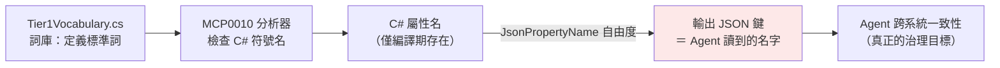

# Issue #15 - 詞彙標準化未送達 Agent 可見的輸出 JSON 層；鏡射 tool 缺乏契約規則

> **狀態**：已決議（2026-10-22 逐項確認，見 §6；實作依 §7 進行）。決策正式記錄為 [ADR-016](../architecture/adr/ADR-016-agent-layer-output-contract-standardization.md)。
> **追蹤票**：[#15](http://tncimweb.cminl.oa/git-server/CIM-1-3-1/McpGateway.Core/issues/15)（已開，2026-10-22）
> **建立日期**：2026-10-22
> **類型**：Architecture / Agent DX / Tech Debt
> **前置**：[Issue #11](issue-11-glossary-tier-governance.md)（單層詞庫）、[Issue #14](issue-14-vocabulary-semantic-boundary.md)（語意邊界與診斷送達）已處理完「詞庫定義什麼」與「C# 層如何強制」；本文件處理標準化鏈條的最後一哩——**Agent 實際讀到的輸出 JSON 鍵名**。

## 1. 問題描述

平台的最終目標：**Agent 跨系統呼叫各部門 MCP tool 時，語意相同的欄位名稱一致，無需逐系統重新學習。** 詞庫（`Tier1Vocabulary.cs`）定義了「什麼叫一致」，分析器（MCP0010）保證了 C# 原始碼層的一致。但盤點發現標準化鏈在輸出層斷裂：

1. **分析器只能檢查到 C# 符號名**。`McpNamingAndDescriptionAnalyzer` 讀取的是 `propertySymbol.Name`（Roslyn 符號層），**不看 `[JsonPropertyName]` 的值**。
2. **`JsonPropertyName` 的值才是 Agent 讀到的鍵名**。MCP SDK 序列化 tool 輸出時遵守 `JsonPropertyName`。因此單層鏡射寫法下，即使 C# 屬性已改為標準詞 `TotalItems`，只要保留 `[JsonPropertyName("totalCount")]`，Agent 讀到的仍是 `totalCount`——**編譯期綠燈，目標層卻沒有標準化**（合格證發給了影子）。
3. **同一目標層存在兩種慣例**：Qsys 同一 repo 內，`Umsapi` 為兩層（鏡射契約 `internal`＋Service 映射＋標準輸出 DTO），`Issapi` 為單層透傳（下游鏡射型別直接作為 tool 回傳型別，下游方言直達 Agent）。三個部門 repo 共四種形態（§3.2），無任何文件判定何者正確。

直接觸發點：Core `0.2.4-preview` 進板後，`McpGateway.Qsys.Issapi` 編譯出現 3 條 `MCP0010`（`TotalCount`→`totalItems`、`CreateTime`→`generatedAt`）。若僅把 C# 屬性改名而保留 `JsonPropertyName`（鏡射契約的自然直覺），警告消失但 Agent 視角完全沒有改善——暴露了上述機制缺口。

## 2. 根本原因分析

### 2.1 標準化鏈條與斷點



`C# 屬性名 → 輸出 JSON 鍵` 之間隔著 `JsonPropertyName` 這個自由度：標了它，輸出鍵就與 C# 名脫鉤。分析器管前段、目標在後段，中間無任何規則或檢查守護——這是**結構性斷點**，不是某人的實作失誤。

### 2.2 現有文件對「鏡射/透傳」場景完全空白

- `mcp-tool-dto-builder` Skill（SKILL/WORKFLOW/CONTRACT_RULES）只示範「原始 schema → 生成新輸出契約」的綠地流程；Step 3 對齊表把「建議標準名稱」寫成 `ProductId / productId`（C# 與 JSON 同名），**隱含假設輸出鍵可自由命名**，未處理「輸出鍵是下游契約、改不動」的鏡射場景。三個技能檔搜 `鏡射|鏡像|兩層|映射|JsonPropertyName|透傳` 零命中。
- ADR-010 要求「工具輸出 DTO 標準化」，但未定義鏡射型 tool 的輸出契約形態。
- 結果：Issapi 的單層不是違反規則——規則根本不存在；Umsapi/Report 的兩層也不是遵循規則——它們自行找到了正確形態。

### 2.3 為何單層在編譯期「看起來沒問題」

`MCP0010` 只標「命中詞庫別名」的 C# 名。Issapi 大量下游方言（`clmDate`、`pageNo`、`bplanJobFull` 等 20+ 鏡射 DTO 的全部欄位）**不在詞庫中，零警告，但照樣直達 Agent**。3 條警告嚴重低估了 Agent 層的暴露面。

### 2.4 效能不是障礙

兩層映射為純屬性拷貝（微秒級，對比下游 HTTP 數百 ms）。兩層伴隨的欄位裁剪反而降低 Agent 端 token 成本——對 MCP 場景，token 才是真實瓶頸，全量鏡射（如 58 欄 snake_case 直出）是最貴的形態。

## 3. 影響範圍

### 3.1 受影響的層

| 層 | 現狀 | 與目標的差距 |
|---|---|---|
| Agent 可見輸出 JSON 鍵 | 鏡射 tool 透傳下游方言（`totalCount`/`createTime`/snake_case） | 跨系統不一致，詞庫投資對 Agent 零作用 |
| 分析器覆蓋 | 僅 C# 符號名 | 對目標層無約束力，`JsonPropertyName` 可規避 |
| Skill / ADR | 無鏡射場景規則 | 新 tool 的形態靠各 repo 自行決定 |

### 3.2 現況盤點（2026-10-22 查證，四模組證據）

| 模組 | 結構 | tool 回傳型別 | Agent 視角 | 證據 |
|---|---|---|---|---|
| Qsys **Umsapi**（3 tool） | ✅ 兩層 | `*Response`/`*ItemDto`（Gateway 契約） | 正名（上游 `l30DeptId` 於 Service 映射為 `deptId`） | `Models/UmsApiContracts.cs`（鏡射契約標 `internal`，檔頭註明「不作為 MCP tool 輸出」）、`Services/UmsapiReportService.cs` 的 `Map*()`、`Models/ReportDtos.cs`（依 Skill 契約命名） |
| Report **Mfg**（1 tool） | ✅ 兩層 | `WipItemDto`（詞庫標準詞） | 標準詞（`processId`/`lotCnt`/`stayHours`…） | `Models/MfgWipRawRecord.cs`（鏡射）→ `Services/MfgReportService.cs` 映射 → `Models/WipItemDto.cs` |
| Qsys **Issapi**（18 tool） | ❌ 單層 | 下游鏡射 DTO 直接 return | ISS 方言（`totalCount`/`createTime`/`clmDate`…） | `Tools/IssapiQueryTool.cs` 以 `GetAsync<GurobiInfeasibleOutDto>()` 直接回傳；3 條 MCP0010 |
| Mes **Arymes**（1 tool） | ❌ 單層（刻意忠實鏡射） | 58 欄鏡射 DTO | 下游 snake_case（C# 名已標準化故 0 警告） | `Models/CarrierPositionDtos.cs`；ReleaseNote 載明「完整鏡射」為設計 |

## 4. 方案評估

### 方案 N：維持現狀，僅修 3 條警告（C# 改名、保留 JsonPropertyName）— 排除

警告消失，但 §1 的機制缺口原封不動：下一批鏡射 tool 仍會把新方言送給 Agent，且「已標準化」的錯覺更難糾正。只處理 1% 的暴露面。

### 方案 W：只寫文件、不加機器守護 — 不足

在 ADR/Skill 寫明兩層規則，但分析器仍管不到輸出層，破窗只能靠 code review 攔。與 Issue #14 的教訓相悖——該案正是把「靠註解/文件把關」升級為「CI 測試強制」。

### 方案 R：架構規則＋分析器強制（MCP0013）＋存量遷移 — **✅ 已採決議（2026-10-22，見 §6）**

規則收斂 `JsonPropertyName` 的自由度，使「分析器檢查 C# 名」重新等價於「檢查 Agent 讀到的鍵」：

- **R1（規則）**：MCP tool 的回傳型別（輸出契約）不得標註 `[JsonPropertyName]`；鏡射/上游契約型別必須標 `internal` 且只准出現在 Service 層內部。輸出 JSON 鍵一律由 C# 屬性名的 camelCase 推導 → 詞庫標準詞直接成為 Agent 可見鍵名。配套目錄歸屬約定見 §5.4。
- **R2（強制）**：新增分析器診斷 `MCP0013`，以「追線路」方式判定輸出契約（§5.3），附 Code Fix 指引。過渡採預設降級：Core 發版時預設 severity `suggestion`（不擋建置），下游在遷移完成的 PR 中逐專案以 `.editorconfig` 收為 `warning`（§6 #11）。
- **R3（遷移）**：新 tool 立即適用；存量 Issapi 18 tool 一次全部兩層化＋目錄搬移（§6 #10）；Mes Arymes 同樣兩層化——機械性（C# 名已標準化，輸出契約≈現行 DTO 去 `JsonPropertyName`），不設豁免 attribute（§6 #3 推翻記錄）；Report Mfg 僅目錄對齊。

## 5. 設計（方案 R，§6 決議已確認）

### 5.1 目標形態（以 Umsapi 為範本，非新發明）

```csharp
// ① 鏡射契約：internal、跟隨下游 JSON 鍵，止於 Service 層
internal sealed class UpstreamGurobiInfeasibleResult {
    [JsonPropertyName("totalCount")] public int TotalCount { get; set; }
    // ...
}

// ② Service 映射（唯一允許出現「鏡射 → 輸出」轉換的地方）
private static GurobiInfeasibleResponse MapResult(UpstreamGurobiInfeasibleResult u) => new(
    TotalItems: u.TotalCount,      // 下游方言 → 詞庫標準詞
    GeneratedAt: u.CreateTime,
    // ...
);

// ③ 輸出契約：public record、無 JsonPropertyName、欄位 = 詞庫標準詞
public sealed record GurobiInfeasibleResponse(
    [property: Description("符合查詢條件的項目總筆數…")] int TotalItems,
    [property: Description("報告/資料產出之 UTC 時間戳記…")] DateTimeOffset? GeneratedAt,
    // ...
);
```

三層各司其職：① 對下游負責（契約改不動）、② 翻譯、③ 對 Agent 負責（詞庫標準詞）。分析器檢查 ③ 的 C# 名時，輸出的 JSON 鍵必然與之一致——鏈條閉環。

三類契約的正式術語（**鏡射契約／輸出契約／契約映射**）已收錄 [GLOSSARY.md](../../GLOSSARY.md)「Tool 契約」段，Issue、ADR 與代碼統一使用該組詞。

### 5.2 MCP0013 診斷草案

| 項目 | 內容 |
|---|---|
| ID / 嚴重性 | `MCP0013` / Warning，**新建獨立 `McpOutputContractAnalyzer`**——可達性集合是編譯層狀態，以 `CompilationStartAction` 建一次並快取，與逐屬性規則（0010/0011/0012）的生命周期分開；檔邊界＝規則邊界（§6 #2） |
| 觸發條件 | 型別屬 tool 回傳可達閉包（判定見 §5.3），且屬性標註 `JsonPropertyName` |
| 訊息（中文化，比照 0.2.4 慣例） | 「輸出契約屬性 '{0}' 標註了 JsonPropertyName，Agent 將讀到非詞庫鍵名 '{1}'；鏡射契約請標 internal 並止於 Service 層，輸出欄位請使用詞庫標準詞」 |
| 不觸發 | `internal` 型別；從 tool 回傳線路不可達的型別（設定鏡射、KV 契約、Service 內部型別）；**Core / Analyzers 組件型別一律豁免**（§6 #6）。**無 tool 級豁免機制**——規則絕對，見 §6 #3 推翻記錄 |
| 範圍 | 第一版只強制輸出側；輸入契約同受 R1 規則約束（tool 參數亦為對 Agent 的承諾），檢查於後續版本補上（§6 #5） |
| Code Fix | 提示改由契約映射處理（不做自動搬移——輸出契約改名是契約變更，需人工確認） |
| 過渡 | Core 發版時預設 severity `suggestion`（不擋建置）；下游各專案在遷移完成的 PR 中把 `.editorconfig` 收為 `warning`，遷移一批收一批（§6 #11） |

### 5.3 輸出契約的判定機制：從 tool 簽名「追線路」，不靠類別名字

**現行機制的限制**：`IsMcpDtoOrTool`（`src/McpGateway.Analyzers/McpNamingAndDescriptionAnalyzer.cs:136`）以「類別名字後綴為 `Dto`/`Response`/`Item`…」推測 MCP DTO。對 MCP0010/0011（命名建議）這種寬鬆推測尚可容忍，但對 MCP0013（管 `JsonPropertyName` 能不能標）會造成兩類誤判：

| 反例 | 實際身份 | 後綴推測結果 |
|---|---|---|
| Report `Models/ConsulShopItem.cs` | Consul KV 設定檔鏡射，從不進 tool 輸出 | 結尾 `Item` → 被誤判為輸出契約（**偽陽性**，會被 MCP0013 誤罰） |
| Report `Models/MfgWipRawRecord.cs` | 下游鏡射契約 | 結尾 `Record` 不在清單 → 漏判（僥倖目前無需管它） |

**MCP0013 改用可達性追蹤**（Roslyn 符號層可精確做到）：

```
1. 找所有標 [McpServerTool] 的方法（MCP003 分析器已有此掃描）
2. 取各方法的回傳型別，剝除 Task<> / IAsyncEnumerable<> / IReadOnlyList<> 等容器
3. 遞迴展開該型別的屬性型別（record positional 參數同理）
4. 可達集合內的 public 型別 ＝ 該模組的輸出契約閉包
```

類比：判定「哪些包裹會寄給客戶」，不看盒子上的字猜（猜名字），而是從出貨單抄收件人（追 tool 回傳線路）。

性質：

- `ConsulShopItem` 從任何 tool 簽名都不可達 → 自動豁免，不需豁免清單。
- 與 R1 規則互相咬合：鏡射契約依規標 `internal` 藏在 Service 後 → 天然不可達 → 天然免檢。規則與檢查共用同一個事實，不需要額外機制。
- 輸入契約不在回傳閉包內：第一版 MCP0013 只實作輸出側（§6 #5）。輸入契約同受 R1 約束（tool 參數標 `JsonPropertyName` 同樣會偏離 Agent 所見的標準詞），輸入側檢查（從 tool 參數型別追閉包，機制對稱）列後續版本。
- 跨專案可見性：tool 與 DTO 同屬一次編譯的依賴圖，可達性可跨專案追蹤。
- 成本：一個 `CompilationStartAction` 建一次可達集合并快取，較後綴推測多數十行代碼。
- Core / Analyzers 組件定義的型別一律豁免（以 `IAssemblySymbol` 判斷）：Core 的 DTO（如 `ErrorResponse`、`UacApiKeyIdentityResponse`）是外部系統契約，帶 `JsonPropertyName` 正當（§6 #6）。

**現有後綴啟示保留給 MCP0010/0011/0012 不動**——這不是未竟的升級，而是範圍語意不同：MCP0013 問「JSON 鍵是否可達 Agent」，需精準、誤報代價高；MCP0010/0012 問「C# 識別符是否合規」，命名紀律對**所有**代碼有效、**含鏡射契約本身**（Mes 已證明鏡射契約的 C# 名亦須標準詞——這正是 §6 #3 推翻豁免的前提）。若 0010 改用可達性追蹤，鏡射契約標 `internal` 後即不可達，反而**逃過別名檢查、製造盲點**；後綴啟示的過度近似對命名紀律是特性（誤報僅多一條建議，成本趨零）。記錄 `ConsulShopItem` 類偽陽性為已知限制。MCP0011（Description 服務 Agent schema）理論上可縮至可達∪輸入閉包，但誤報成本低，不列本期。

**已知空隙——鏡射契約暴露在 public Service 介面**：R1 要求鏡射契約「只准出現在 Service 層**內部**」，但 Report 現況 `IMfgReportService.FetchRawWipAsync` 回傳 `MfgWipRawRecord`（public 介面掛鏡射契約）——違反 R1，卻**不在 MCP0013 範圍內**（鏡射契約不在 tool 回傳閉包，不可達即不報）。此類洩漏由 R1 規則＋code review 把關，處置方式：Service 介面收 `internal`（其消費者僅同組件的 Tool 與 DI 註冊，可行），或把回傳鏡射契約的方法移出介面（屬實作細節）。已列 §7.2 #7。

### 5.4 契約與目錄佈局約定（導航輔助，非判定權威）

現狀三種契約（鏡射／輸出／內部）混放於同一 `Models/` 資料夾，辨別身份只能讀檔頭註解或追引用——`UmsApiContracts.cs` 需以一大段註解自我聲明「不作為 MCP tool 輸出」，正是結構無法自我表達的訊號。建議的模組內佈局：

```
src/McpGateway.Qsys.Issapi/
├── Contracts/      ← ① 鏡射契約：全部 internal，跟隨下游 JSON 鍵
│   └── UpstreamGurobiInfeasible.cs        （[JsonPropertyName] 只准出現在這裡）
├── Dtos/           ← ③ Agent 可見輸出契約：public，欄位 = 詞庫標準詞
│   └── GurobiInfeasibleResponse.cs        （禁止 [JsonPropertyName]）
├── Services/       ← ② 映射發生地（Map*()）
└── Tools/
```

定位與邊界：

- **價值**：資料夾結構是開發者與 AI 修改代碼前的第一道導航，「`JsonPropertyName` 只准出現在 `Contracts/`」是 5 秒可記、code review 一眼可查的約定；腳手架（`add-subsystem`/`add-tool`）可直接生成正確骨架，新 tool 從第一天站對位置。
- **邊界**：目錄是約定、會破窗（放錯夾子不會抗議），「靠位置猜」與「靠名字猜」（§5.3 的 `ConsulShopItem` 教訓）是同類錯誤的另一個版本。**判定權威僅有 §5.3 可達性追蹤，目錄不具任何觸發權**（§6 #2）：型別放進 `Dtos/` 但不可達 → 不報（`ConsulShopItem` 放進去也不會被誤罰）；放錯目錄但可達 → 照報。
- **遷移**：目錄搬移與兩層化同批進行（都要動 import），不另立工程。

### 5.5 文件與技能同步

- **ADR**：新增 [ADR-016](../architecture/adr/ADR-016-agent-layer-output-contract-standardization.md)（本決策正式記錄），ADR-010 加交叉引用（§6 #8）。
- **Skill**：`mcp-tool-dto-builder/CONTRACT_RULES.md` 增「鏡射/透傳契約規則」一節（補 §2.2 空白）；Qsys `add-subsystem`/`add-tool` 技能的工作範本與 worked-example 改照兩層，pitfalls 增「單層透傳＝反模式」條目；Core `templates/` 腳手架生成 `Contracts/`＋`Dtos/` 骨架與契約映射範例。
- **詞庫**：不動（`totalItems`/`generatedAt` 維持標準詞；本 Issue 是執行機制，非詞條變更）。GLOSSARY.md 新增「Tool 契約」段（鏡射契約／輸出契約／契約映射）屬架構語言，與欄位詞庫分層。

### 5.6 各 repo 影響範圍（2026-10-22 盤點）

| Repo | 變動 | 依據 |
|---|---|---|
| Core | `McpOutputContractAnalyzer`（MCP0013，無豁免 attribute——不新增公開 API）；ADR-016；CONTRACT_RULES 新節；templates 骨架 | §6 #2/#3/#8/#9 |
| Qsys | **最大**：Issapi 18 tool 全量兩層化＋目錄搬移＋契約映射；Umsapi 僅目錄對齊；`add-subsystem`/`add-tool` 技能改兩層 | §6 #10、§5.4 |
| Mes | **機械性**：Arymes 兩層化——鏡射契約搬 `Contracts/`（標 internal），輸出契約≈現行 DTO 去 `JsonPropertyName`（C# 名已標準化），來源欄名寫進 Description；Agent 鍵名 `stay_hours`→`stayHours` 屬 BREAKING | §6 #3 推翻記錄 |
| Report | 僅目錄對齊（已是兩層典範） | §5.4 |

## 6. 決議記錄（2026-10-22 逐項確認）

| # | 事項 | 決議 |
|---|---|---|
| 1 | 方案方向 | 採行方案 R（架構規則＋MCP0013＋存量遷移）；N（只修警告）、W（只寫文件）排除 |
| 2 | 判定機制與落點 | 可達性追蹤為**唯一判定權威**，`Contracts/`＋`Dtos/` 目錄僅為導航輔助、**不具觸發權**（放錯目錄不影響判定）；新建獨立 `McpOutputContractAnalyzer` |
| 3 | 忠實鏡射 tool | ~~允許存在，以 `[FaithfulMirror]` attribute 豁免~~ **→ 推翻（同日稍後，2026-10-22）**：不設豁免 attribute，規則絕對無例外。理由：該 attribute 唯一保護的是「Agent 讀到下游鍵名」，這正是本決策要消滅的不一致（Mes 的 `stay_hours` vs Report 的 `stayHours`）；「忠實鏡射」的忠實應指**資料完整性**（58 欄全可空、值不加工），與鍵名無關——兩層化可完整保留前者。Mes 同樣兩層化，成本機械性；下游來源欄名寫進輸出契約的 `[Description]`（如「下游欄位 `dpiqcrrxo.STAY_HRS`」），對照能力由描述承載——與詞庫「描述承載語意」手法一致。連帶取消 Core 唯一的新增公開 API |
| 4 | 豁免範圍 | ~~`[FaithfulMirror]` 僅豁免 MCP0013~~ → 隨 #3 推翻而失效；MCP0010/0011/0012 與 MCP0013 對所有 tool 一律有效，僅剩 §5.2「不觸發」列的結構性豁免（internal／不可達／Core 組件） |
| 5 | 規則適用邊界 | R1 對稱適用於輸入＋輸出契約；MCP0013 第一版只實作輸出側，輸入側檢查後續版本補上 |
| 6 | Core 組件 | 定義於 Core / Analyzers 組件的型別一律豁免 MCP0013（外部系統契約，`JsonPropertyName` 正當） |
| 7 | 術語 | 「鏡射契約／輸出契約／契約映射」定案，✅ 已寫入 [GLOSSARY.md](../../GLOSSARY.md)「Tool 契約」段（2026-10-22） |
| 8 | 決策記錄形式 | 新增 [ADR-016](../architecture/adr/ADR-016-agent-layer-output-contract-standardization.md)，ADR-010 加交叉引用 |
| 9 | 目錄佈局 | 採行 §5.4 `Contracts/`＋`Dtos/` 約定（明示非判定權威）；腳手架生成該骨架 |
| 10 | Issapi 遷移範圍 | **18 tool 一次全部完成**（統一契約、一次 BREAKING 公告），不分批 |
| 11 | 時序 | Core 先發 MCP0013（預設 `suggestion` 不擋建置），下游在遷移 PR 中逐專案 `.editorconfig` 收為 `warning` |
| 12 | 契約變更告知 | 硬切，舊鍵不保留、不做雙鍵過渡；ReleaseNote 標 BREAKING＋通知已知 Agent 整合方 |
| 13 | 欄位裁剪 | 契約映射預設與鏡射契約 1:1；允許逐 tool 有理由裁剪（token 收益），裁剪決定必須記錄於遷移 PR 的欄位對齊表（比照 mcp-tool-dto-builder Step 3 確認閘門） |

## 7. 實作計畫與驗證

### 7.1 Core（先行，目標版本 0.2.5-preview）

| # | 項目 | 驗證方式 |
|---|---|---|
| 1 | `McpOutputContractAnalyzer`：可達性閉包＋MCP0013（預設 severity `suggestion`）；不觸發分支＝`internal`／不可達／Core 組件（無 tool 級豁免，§6 #3 推翻記錄） | Analyzers 測試：tool 可達正例、`internal` 反例、設定鏡射不可達反例（`ConsulShopItem` 形態）、Core 型別豁免反例；`dotnet test` 通過 |
| 2 | [ADR-016](../architecture/adr/ADR-016-agent-layer-output-contract-standardization.md)＋ADR-010 交叉引用 ✅（已隨本文件完成，2026-10-22）；`CONTRACT_RULES.md` 增「鏡射/透傳契約規則」一節 ⬜ | 人工審閱；與 §5.1 範本一致 |
| 3 | `templates/`（scaffold/add-module/template-module）生成 `Contracts/`＋`Dtos/` 骨架與契約映射範例 | 全新 scaffold 專案 build 通過，範例含鏡射→映射→輸出三層 |

### 7.2 下游（Core 0.2.5-preview 發佈後）

| # | Repo | 項目 | 驗證方式 |
|---|---|---|---|
| 4 | Qsys | Issapi 18 tool 全量兩層化＋目錄搬移（`Contracts/`＋`Dtos/`）；契約映射預設 1:1，裁剪逐 tool 記錄於 PR 對齊表；`.editorconfig` 收 MCP0013 為 warning | `dotnet build` 0 警告；`tools/list` 輸出 schema 鍵全為詞庫標準詞；測試更新後全綠；ReleaseNote 標 BREAKING＋通知整合方 |
| 5 | Qsys | Umsapi 目錄對齊（`UmsApiContracts.cs`→`Contracts/`、`ReportDtos.cs`→`Dtos/`）；`add-subsystem`/`add-tool` 技能與 worked-example 改兩層流程 | build/test 通過；技能範本與 §5.1 一致 |
| 6 | Mes | Arymes 兩層化（機械性）：鏡射契約標 internal 搬 `Contracts/`；輸出契約去 `JsonPropertyName`、來源欄名寫進 `[Description]`；`.editorconfig` 收 MCP0013 為 warning；ReleaseNote 標 BREAKING（`stay_hours`→`stayHours` 等） | build 0 警告、test 通過；`tools/list` schema 鍵為標準詞 |
| 7 | Report | Mfg 目錄對齊（`MfgWipRawRecord`→`Contracts/`、`WipItemDto`→`Dtos/`）；`IMfgReportService` 收 `internal` 或將 `FetchRawWipAsync`（回傳鏡射契約）移出介面（§5.3 已知空隙）；`.editorconfig` 收 warning | build/test 通過；public 表面不再出現鏡射契約 |
| 8 | 跨 repo 驗收 | 同一 Agent 對照 Report 與遷移後 Issapi 的同語意欄位 | 鍵名一致（`totalItems`/`generatedAt` 等），無需逐系統學習 |

## 8. 相關文件

- [ADR-016](../architecture/adr/ADR-016-agent-layer-output-contract-standardization.md) — 本決策的正式記錄
- [Issue #11](issue-11-glossary-tier-governance.md) — 詞彙治理單層化（詞庫權威來源）
- [Issue #14](issue-14-vocabulary-semantic-boundary.md) — 語意邊界與診斷送達（本 Issue 處理其下游的輸出層）
- [ADR-010](../architecture/adr/ADR-010-mcp-tool-field-standardization-and-structured-dto.md) — 工具輸出 DTO 標準化（已加 ADR-016 交叉引用）
- [ADR-014](../architecture/adr/ADR-014-intra-department-subsystem-modules.md) — 子系統模組（tool 回傳型別所在層）
- [GLOSSARY.md](../../GLOSSARY.md)「Tool 契約」段 — 鏡射契約／輸出契約／契約映射 正式術語
- `docs/ai-tools/skills/mcp-tool-dto-builder/CONTRACT_RULES.md` — 待補鏡射/透傳契約規則
- 範本證據：Qsys `Umsapi`（`UmsApiContracts.cs`/`UmsapiReportService.cs`/`ReportDtos.cs`）、Report `Mfg`（`MfgWipRawRecord.cs`→`WipItemDto.cs`）
